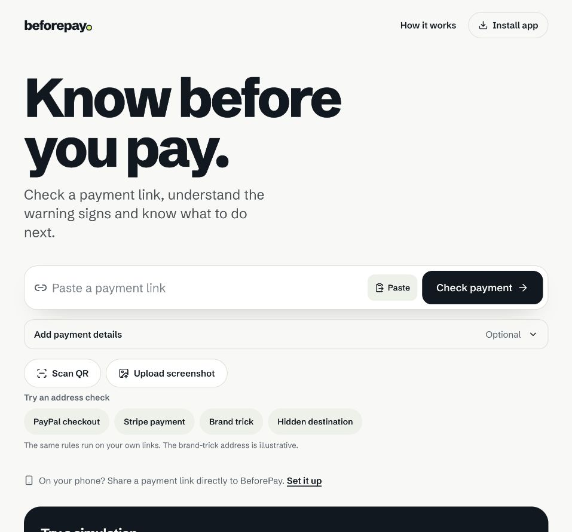
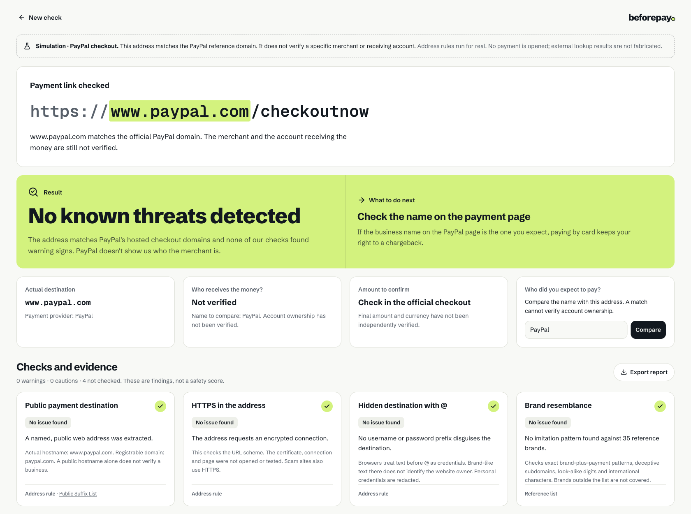

<p align="center">
  
</p>
<h1 align="center">BeforePay</h1>
<p align="center"><strong>Know before you pay.</strong><br />Understand a payment link before your money leaves.</p>
<p align="center">
  <a href="https://aleetreny.github.io/beforepay/">Open the app</a> ·
  <a href="#try-the-three-paypal-examples">Try the demo</a> ·
  <a href="docs/methodology.md">How the checks work</a>
</p>
<p align="center">
  <a href="https://github.com/aleetreny/beforepay/actions/workflows/pages.yml"></a>
  
  
</p>



A familiar brand name, a padlock and a payment-provider logo can leave the most important question unanswered: **who receives the money?**

BeforePay turns links, pasted messages and QR codes into an interpretable report. It shows the real destination, explains each warning and separates the website provider, merchant, payment processor and final recipient.

Add payment details only when useful: the expected business, payment method, amount and message wording. The result starts with a short payment summary and a next step; all checks, sources and identity records remain visible in balanced columns. Screenshots are read locally, and extracted links must be reviewed before checking.

## Try the three PayPal examples

These examples run the real address rules with no fabricated registry dates or threat-feed results. They never open a payment page.

| Example | Open the report | What it demonstrates |
| --- | --- | --- |
| Official PayPal address | [PayPal checkout](https://aleetreny.github.io/beforepay/?demo=paypal-official) | Recognised provider domain; receiving merchant remains unknown. |
| Disguised destination | [The `@` trick](https://aleetreny.github.io/beforepay/?demo=paypal) | `paypal.com@payments.example` goes to `payments.example`. |
| Personal payment | [PayPal.Me](https://aleetreny.github.io/beforepay/?demo=paypal-personal) | A handle does not establish who owns the receiving account. |

**QR demo:** [download this QR image](public/demo-qr-warning.png), then use **Scan QR** on another device or **Upload screenshot**. Its payload is the illustrative `@` trick, not a live payment.

## What works today

| Capability | Public app |
| --- | --- |
| Extract a payment URL from a message | On-device, with validation and multiple-link detection |
| Parse real domain, subdomains, credentials and Unicode | On-device; Public Suffix List via `tldts` |
| Identify brand deception and spelling similarities | 35 curated reference brands; strong patterns and weaker similarities are distinguished |
| Recognise hosted checkouts and personal payments | Provider reference rules; no assumed beneficiary identity |
| Domain registration age | Live public RDAP lookup when the registry responds |
| Hostname availability | Live Cloudflare DNS lookup, using only the hostname |
| Compare the expected merchant | Exact brand reference checks and cautiously labelled name consistency |
| Decode camera/image QR codes | On-device via `jsQR`; camera requires browser permission |
| Read a link from a screenshot | On-device OCR via Tesseract.js; review and correct the extracted address |
| Explain payment context | Optional method, amount and message checks; amount and recipient remain independently unverified |
| Explain and export a report | All criteria and sources visible in balanced columns; redacted JSON export |
| Open a domain in VirusTotal | Optional external link; no payment path or token is included |



Three possible outcomes: **No known threats detected**, **Identity not verified**, and **Warning signs detected**. A result is never a safety guarantee or a probability of fraud.

### Optional integrations

The public app runs independently on GitHub Pages. Companies House and Google threat handlers are prepared under `api/`, but Pages cannot execute server code. They remain **Not checked** in the public app until a separate backend is explicitly configured. Local screenshot OCR needs no key. See the [key setup guide](docs/API_SETUP.md) and `.env.example`. VirusTotal scanner results are not connected to BeforePay.

Domain age, DNS, HTTPS and a similar company name cannot verify a merchant. The actual recipient remains **Not verified** without trusted bank/payment-side evidence.

## Run locally

Use Node.js 24 LTS and npm.

```bash
git clone https://github.com/aleetreny/beforepay.git
cd beforepay
npm ci
npm run dev
```

The development server serves the UI and optional API handlers. Without keys, core rules, RDAP, DNS and demos still work.

```bash
npm test             # existing engine and regression suite
npm run build        # root-hosted production build
npm run build:pages  # /beforepay/ build for GitHub Pages
npm run preview      # preview the production output
```

The repository includes engine, context, OCR-candidate and API regression checks, with a corpus of 114 distinct addresses covering reference domains, strong deception, ordinary names, personal/platform payments and network destinations. These are rule-regression checks, not an estimate of real-world detection accuracy. Mock API tests do not establish that a real key has access; that must be checked after configuration.

## Privacy and limits

- The public app does not fetch the payment page, follow its redirects or initiate a payment.
- It has no accounts or saved check history. Reports stay in the current tab unless you copy or export them.
- Sensitive query values, long identifiers and personal URL credentials are redacted in reports and shared links.
- RDAP receives the registrable domain; Cloudflare DNS receives the hostname. Neither receives the payment path or token.
- Optional Google checks receive the submitted destination URL; Companies House receives the company search term. Message and amount stay in the current tab and are excluded from shared links.
- Screenshot images stay on-device. The OCR reader downloads public code/model files when first used; it can fail offline or with unclear text.
- Registry outages, browser restrictions and network errors are shown as unavailable data.
- No offline reload is promised. The app retires old service-worker caches to keep mobile clients current.
- This is a hackathon prototype and an information tool. It does not inspect TLS certificates or page content and cannot establish who owns a receiving account.

Read [the methodology](docs/methodology.md) for decision rules and evidence boundaries, and [the demo guide](docs/demo.md) for a short walkthrough.

## Deployment

GitHub Actions builds and publishes `dist/` to Pages on every push to `main`. The site uses `/beforepay/` and query-based report links, so direct demo links and reloads work on static hosting. `build-info.json` records the exact published Git commit. [GitHub Pages documentation](https://docs.github.com/en/pages/getting-started-with-github-pages/using-custom-workflows-with-github-pages) · [Vite deployment documentation](https://vite.dev/guide/static-deploy.html#github-pages).

## Provenance

Built for the Fintech Hackathon in London, 13 October 2026. This edition continues the team prototype in [u199327/beforepay](https://github.com/u199327/beforepay), with its original Git author history retained. Original report and pitch documents are preserved in [docs/archive](docs/archive/README.md); they describe an earlier snapshot.
